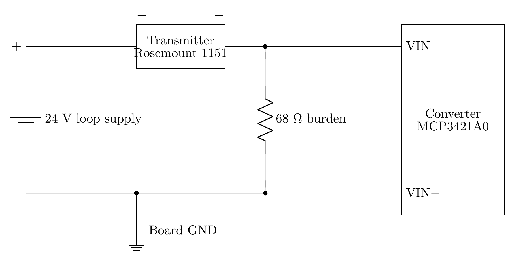

# Pressure Loop Wiring — PLC #4 Tractor Scale

**Document:** 02 — Pressure Loop Wiring
**Firmware:** `uno_r4_wifi` build `699e3c6c`
**Updated:** 2026-10-25

## Parts

| Part | Specification |
|---|---|
| Transmitter | Rosemount 1151 [1], 0–3000 psi [2], two-wire 4-20 mA, output code S or E [1] |
| Loop supply | Dedicated 24 V, separate from the board supply [3] |
| Burden resistor | 68 Ω, 0.1 %, 25 ppm/°C or better [4]. A 150 Ω burden clips the converter at 13.65 mA [4] |
| Converter | MCP3421A0, address `0x68`, 18-bit, used at 14 bit, own 2.048 V reference [4], [5], [6] |

## Connections

| Terminal | Function | Wire | Connected to |
|---|---|---|---|
| Loop supply + | 24 V out | | Transmitter + |
| Transmitter + | Loop current in [7] | | Loop supply + |
| Transmitter − | Loop current out [7] | | Burden, transmitter end; converter VIN+ |
| Burden, transmitter end | | | Transmitter −; converter VIN+ |
| Burden, supply end | | | Loop supply −; converter VIN− |
| Converter VIN+ | Positive differential input [5] | | Transmitter −; burden, transmitter end |
| Converter VIN− | Negative differential input [5] | | Loop supply −; burden, supply end |
| Loop supply − | Loop return | | Burden, supply end; converter VIN−; board ground, `01` §*Header pins* |

The schematic is `schematics/pressure_loop.png`, drawn from `schematics/pressure_loop.tex`.

| Design point | Value |
|---|---|
| Burden placement | Return leg, between the transmitter negative and the loop supply negative |
| Converter input voltage | Each input stays between VSS − 0.3 V and VDD + 0.3 V [5]. A burden in the supply leg puts the loop supply on the inputs, beyond that range |

## What each current means

| Loop current | Across the burden | Meaning |
|---|---|---|
| Below 3.5 mA | Below 0.238 V | Dead loop: cut wire, no supply, transmitter removed [4] |
| 4.0 mA | 0.272 V | Live zero, 0 psi [4] |
| 20.0 mA | 1.360 V | Full scale, 3000 psi [2], [4] |
| 21.0 mA and above | 1.428 V and above | Transmitter fault [4] |

| Design point | Value |
|---|---|
| Transmitter alarm | Driven below 3.9 mA or above 21 mA on a gross failure, output code S [1] |
| Converter full scale | 2.048 V [5], 30.1 mA through 68 Ω. A current above the 21 mA fault threshold reads as a fault, not as full scale |

## Supply

| Item | Value |
|---|---|
| Transmitter supply | 12 to 45 V dc at the transmitter terminals, output codes S and E [1] |
| Burden drop | 1.36 V at 20 mA, leaving 22.64 V at the transmitter from 24 V |

## References

[1] Emerson Process Management, "Rosemount 1151 Pressure Transmitter," Product Data Sheet 00813-0100-4360, Rev. JB, §*Power Supply* and §*Failure Mode Alarm*. Filed in `docs/vendor/emerson-rosemount/`

[2] A. Pennington, *greybeard-plc4-tractor-scale*, `src/ArduinoHydraulicScale.cpp`, line 71, at the stamped build. License: none stated. [Online]. Available: https://github.com/Alex-Pennington/greybeard-plc4-tractor-scale

[3] A. Pennington, *greybeard-plc4-tractor-scale*, `MA-LOOP-DESIGN.md`, lines 61–62, design record. License: none stated. [Online]. Available: https://github.com/Alex-Pennington/greybeard-plc4-tractor-scale

[4] A. Pennington, *greybeard-plc4-tractor-scale*, `include/loop_scaling.h`, lines 20–59, at the stamped build. License: none stated. [Online]. Available: https://github.com/Alex-Pennington/greybeard-plc4-tractor-scale

[5] Microchip Technology, "MCP3421 18-bit analog-to-digital converter with I2C interface and on-board reference," datasheet DS22003E, §3.1 *Analog Inputs*. Filed in `docs/vendor/microchip/`

[6] A. Pennington, *greybeard-plc4-tractor-scale*, `include/mcp3421.h`, lines 8–22, at the stamped build. License: none stated. [Online]. Available: https://github.com/Alex-Pennington/greybeard-plc4-tractor-scale

[7] Emerson Process Management, "Rosemount 1151 Pressure Transmitter," Reference Manual 00809-0100-4360, Rev. BA, §2 *Wiring*. Filed in `docs/vendor/emerson-rosemount/`
